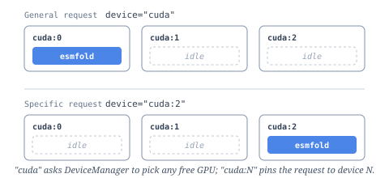
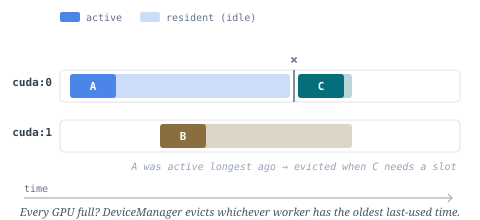
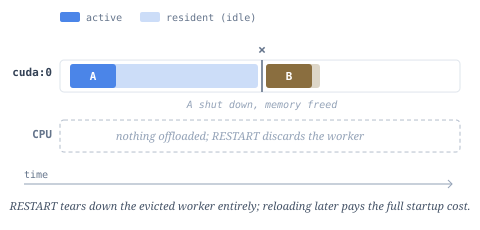
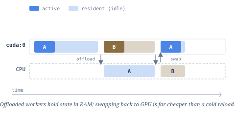
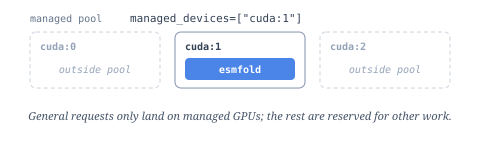
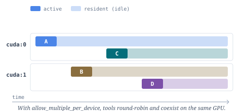

# Device Management Reference

This note covers how `proto_tools` places model workers on GPUs, evicts them
under memory pressure, and moves them between GPU and CPU through `DeviceManager`.
For a walkthrough, see the Device Management guide. This note explains the
implementation.

Source of truth: `proto_tools/utils/device_manager.py`,
`proto_tools/utils/device.py`, and the `to_device()` protocol in
`notes/tool-environments.md`.

## Mental model

Each tool's config carries a `device` field. `DeviceManager` is a process-wide
singleton (`DeviceManager.get_instance()`) that tracks every GPU allocation,
places new workers on free managed GPUs, and evicts the least-recently-used
worker when the pool is full. By default, each GPU holds one worker. Evicted
workers restart the next time they are used.

## Device strings

`device` resolves through `parse_device_string` (`device.py`) into a
`DeviceSpec`. You can request a device in two ways.

- **General**. Name a class and let DeviceManager choose the physical device,
  such as `"cpu"`, `"cuda"` (one GPU), or `"cudax2"` / `"cudax3"` / … (N GPUs). This form is
  preferred because it needs no knowledge of which GPUs are free and triggers eviction
  automatically when they are not.
- **Specific**. Name exact devices, such as `"cuda:0"`, `"cuda:0,1"` or
  `"cuda:0,cuda:1"`. DeviceManager honors the request and evicts whatever
  occupies the slot if it is taken.

Device indices are **logical**. They refer to the GPUs visible after
`CUDA_VISIBLE_DEVICES` filtering, not physical bus IDs.



## The allocation map

DeviceManager holds an allocation per live worker in `_allocations` (keyed by
instance name). Each `DeviceAllocation` records `toolkit`, `device_ids`,
`allocated_at`, `last_used`, an `eviction_callback`, and an `allocation_type`:

- `AllocationType.PERSISTENT`. A long-lived worker. Evictable by LRU.
- `AllocationType.TRANSIENT`. A one-shot lease (see [Leases](#device-leases-for-one-shot-calls)). Non-evictable, auto-released.

A `ToolInstance` owns at most one worker, so each instance holds its own
allocation. Its name is the instance's cache key when it has one (`"esm2"`,
`"esm2_1"`). An uncached instance gets a unique `"<toolkit>#<n>"`: a direct
`ToolInstance(toolkit)`, or a `persist_tool` nested inside one that already holds
the toolkit's default slot. The name is fixed at the instance's first device
request and released under it at shutdown. Two instances never share a name, so a
second same-toolkit worker on a busy GPU is a real conflict and evicts the first
(see [LRU eviction](#lru-eviction)), rather than starting beside it unseen. On an
`Exclusive_Process` GPU that second worker could not create a CUDA context at all.
To reuse a worker, pass the same instance (`instance=`, or its cache key) rather
than creating another.

`get_device_status()` reports the current placement, including `available_devices`,
`allocations` (name → device, ages, type), `offload_strategy`,
`allow_multiple_per_device`, and per-GPU `gpu_memory` (used/free/total GB), so you can
inspect placement without reading internal state.

```python
DeviceManager.get_instance().get_device_status()["allocations"]
# {"A": {"device_id": "cuda:0", "last_used": ..., "allocation_type": "persistent"}, ...}
```

## LRU eviction

The managed pool is finite. When every managed GPU is occupied and a new worker
needs to load, DeviceManager sorts the **PERSISTENT** allocations by `last_used`
and evicts the oldest, regardless of which GPU it sits on. Every `run_*` call
refreshes its worker's `last_used`, so "least recently used" tracks actual call
activity, not load order. TRANSIENT leases are never evicted.



## Eviction strategies (`offload_strategy`)

What eviction *does* to the displaced worker is set by `offload_strategy` (or
`BIO_TOOLS_OFFLOAD_STRATEGY`):

- **RESTART** (default). `_evict_allocation` terminates the worker's
  subprocess and frees its GPU memory. The next call starts a new subprocess
  and loads the model again.
- **CPU**. The worker's weights are moved into system RAM via the tool's
  `to_device()` and the process is kept alive. Promoting it back to GPU is a
  tensor copy, far cheaper than a reload (for ESMFold, ~9 GB, measured ~8 s back
  from CPU versus ~17 s cold).





Not every tool can stay resident on a GPU or be offloaded to CPU, and for tools that
cannot, DeviceManager falls back to RESTART regardless of the configured
strategy. The CPU strategy is also auto-escalated to RESTART when any GPU is in
Exclusive_Process compute mode, because an evicted subprocess retains its CUDA
context and would block other processes even after offloading to CPU. Physical
movement of loaded weights is the **`to_device()` protocol**
documented in `notes/tool-environments.md`, and the move is bounded by
`DEVICE_MOVE_TIMEOUT` (200 s).

## Managed devices

By default the pool is every visible GPU. Narrow it with
`BIO_TOOLS_MANAGED_DEVICES` (set before any tool runs) or
`configure(managed_devices=[...])` at runtime. General requests then land only
on managed GPUs. Unmanaged cards are never touched by DeviceManager and stay
free for other work on the machine.



## Multiple workers per device

The default is one worker per GPU. With `allow_multiple_per_device=True` (or
`BIO_TOOLS_ALLOW_MULTI_DEVICE=true`), new allocations prefer free GPUs and then
pack onto the least-loaded cards instead of triggering eviction, so several
workers can share a card.



DeviceManager does not track model sizes or estimate memory, so ensuring the packed
models fit is the caller's responsibility, and overcommitting raises an
out-of-memory error.

## Device leases for one-shot calls

One-shot dispatch (`ToolInstance._oneshot`, the non-persistent default) does not
register a long-lived worker. Instead it takes a **TRANSIENT lease**
(`DeviceManager.lease(...)`) for the duration of the call so that concurrent
one-shot calls do not use the same GPU. Leases are non-evictable and
auto-released when the call returns, so they never participate in LRU.

## Explicit requests are always honored

A specific `device=` request always wins. If the named GPU is occupied,
DeviceManager evicts to make room (and logs that it did) rather than redirecting
the request elsewhere. This is what makes specific requests suitable for
benchmarking and reproducing a fixed placement.

## Configuration reference

| Variable | Programmatic | Values |
|---|---|---|
| `BIO_TOOLS_MANAGED_DEVICES` | `managed_devices=[...]` | logical device IDs (`"cuda:0,cuda:1"`) |
| `BIO_TOOLS_OFFLOAD_STRATEGY` | `offload_strategy=OffloadStrategy.{RESTART,CPU}` | `"restart"` / `"cpu"` |
| `BIO_TOOLS_ALLOW_MULTI_DEVICE` | `allow_multiple_per_device=` | `"true"` / `"false"` |

```python
from proto_tools.utils.device_manager import DeviceManager, OffloadStrategy

DeviceManager.get_instance().configure(
    managed_devices=["cuda:0", "cuda:1"],
    offload_strategy=OffloadStrategy.CPU,
    allow_multiple_per_device=False,
)
```

Environment variables are read once at startup, while `configure(...)` applies at
runtime. `DeviceManager.reset_instance()` clears all state (used between
independent examples and in tests).

## Authoring tools for device management

- Implement `to_device(device)` on the model wrapper in `standalone/inference.py`
  (or `run.py`) so the tool can be CPU-offloaded. See `notes/tool-environments.md`.
  Without it, the tool falls back to RESTART.
- Mark a tool `gpu_only=True` when it cannot run on CPU. LRU eviction then
  restarts it instead of offloading, and direct `device="cpu"` is rejected.
- Land on the leased GPU. An unpinned worker sees every GPU, and anything that
  picks "the GPU" itself lands on GPU 0. Route a PyTorch tool through the
  leased `device` string:
  - pass it explicitly (`.to(device)`, `map_location`, Lightning `devices=[index]`).
  - call `set_current_cuda_device(device)` from `standalone_helpers` before
    anything touches CUDA, so `.cuda()`, a bare `"cuda"`,
    `torch.cuda.current_device()`, Triton launches and `empty_cache()` follow it.
  - `move_model_to_device` does this on every move.

  A literal `"cuda:0"` in upstream code is not covered. Patch that call in the
  worker, as Caliby's checkpoint `map_location` and Protenix's
  `DIST_WRAPPER.local_rank` are.
- Mark a tool `pin_visible_devices=True` when it cannot be routed. JAX and
  TensorFlow initialize every visible GPU, and TensorFlow cannot change its
  visible devices after start-up. The worker is then spawned with
  `CUDA_VISIBLE_DEVICES` restricted to its assigned physical GPU(s), which it
  addresses as local `cuda:0..N-1`, and it **respawns** on a device change
  instead of moving in-process. Such tools do not implement `to_device()`. The
  user-facing `device=` selection is unchanged. The logical-to-physical mapping is
  internal.
- On an **Exclusive_Process** host, every GPU tool's worker is pinned
  (`DeviceManager.pins_gpu_workers`), whatever its registration says. A CUDA
  context lives until its process exits, so a worker that moved between GPUs
  in-process would keep holding the old GPU, which then refuses every other
  process. This applies to one-shot calls and ToolPool partitions as well as
  persistent workers. Tests turn it off with the private
  `DeviceManager.get_instance()._auto_pin_exclusive = False` to exercise routing
  on such a node.
- `tests/tool_infra_tests/test_device_manager/test_gpu_lifecycle.py`
  (`--all --ext`, 2 GPUs for the move) runs every GPU toolkit through one worker:
  - it leases `cuda:1` and fails if any process opens a context on another GPU.
  - it moves the tool to `cuda:0` and checks the next run follows.
  - a mock tool evicts it, and it must run on a GPU again.

  Auto-pinning on real GPUs is covered by the spec-pinned toolkits there and by
  `test_auto_pin.py`.

  Run it when changing a GPU tool's device handling or bumping its env, since
  CI has no GPUs.
- Set `device_count` on the `@tool` registration so allocation requests are
  validated (under-allocation errors, over-allocation warns).

For how persistence and pooling drive these allocations, see
`notes/tool-persistence.md`.
